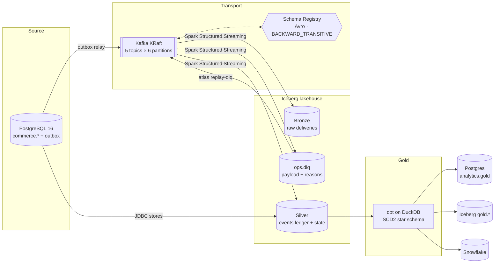

<div align="center">

# AtlasLake

**A streaming + batch lakehouse for commerce data that stays correct under failures, and proves it with measurements.**

[](https://github.com/JCHETAN26/atlaslake/actions/workflows/ci.yml)
[](pyproject.toml)
[](LICENSE)
[](https://github.com/astral-sh/uv)
[](https://github.com/astral-sh/ruff)
[](https://mypy-lang.org/)
[](.pre-commit-config.yaml)

[](https://kafka.apache.org/)
[](https://spark.apache.org/)
[](https://iceberg.apache.org/)
[](https://www.getdbt.com/)
[](https://duckdb.org/)
[](https://airflow.apache.org/)
[](https://www.postgresql.org/)
[](infrastructure/terraform)
[](docker-compose.yml)
[](monitoring)

[Results](docs/RESULTS.md) · [Architecture](docs/ARCHITECTURE.md) · [Spec & decision log](PROJECT_SPEC.md) · [Runbook](docs/RUNBOOK.md)

</div>

---

AtlasLake ingests commerce events (orders, payments, inventory, customers, products) from an
operational Postgres database. It runs them through Kafka and Spark into Apache Iceberg, models them
with dbt into a tested star schema, and publishes Gold to Postgres, Iceberg and Snowflake.

It is built to survive what breaks real pipelines: **crashes, duplicate deliveries, late and
out-of-order events, malformed records, schema changes and historical backfills**. Every
correctness claim is backed by an experiment whose output is committed in [`evaluation/`](evaluation/).

## Table of contents

- [Highlights](#highlights)
- [Architecture](#architecture)
- [Headline results](#headline-results)
- [Guarantees](#guarantees)
- [Quick start](#quick-start)
- [The `atlas` CLI](#the-atlas-cli)
- [Development](#development)
- [CI/CD pipeline](#cicd-pipeline)
- [Observability, lineage and orchestration](#observability-lineage-and-orchestration)
- [Data](#data)
- [Repository layout](#repository-layout)
- [Documentation](#documentation)
- [Scope and limitations](#scope-and-limitations)
- [License](#license)

## Highlights

- **Transactional outbox → Kafka.** Each entity change and its event commit in the same Postgres
  transaction, so no event can exist without its row, and no row without its event.
- **Avro contracts with a registry.** The Schema Registry enforces `BACKWARD_TRANSITIVE`. Consumers
  decode with the *writer's* schema, so v1 and v2 producers coexist and a breaking v3 is rejected.
- **Bronze / DLQ / Silver on Iceberg.** Every physical delivery is kept as raw bytes. Rejected
  records go to a DLQ with reason codes and can be replayed with `atlas replay-dlq`.
- **Exactly-once effects from at-least-once delivery.** Writes are deduplicated against an events
  ledger, and MERGEs are commutative and keyed. Snapshot-level batch keys make every write idempotent.
- **One processor for streaming and batch.** Backfills and Silver rebuilds use the same code path
  as the live stream, and they are verified to produce identical state fingerprints.
- **dbt Gold layer.** SCD2 dimensions, facts with a documented grain and incremental marts, covered
  by 53 dbt tests and 48 Great Expectations checks, with revenue reconciled to Silver to the cent.
- **Event-level reconciliation.** Every source event id is classified as accepted, rejected, in
  flight or pending. Anything *unexplained* fails the run.
- **Operable.** It ships with Prometheus metrics, Grafana dashboards, Alertmanager rules with unit
  tests, OpenLineage/Marquez, Airflow DAGs, AWS Terraform and a runbook.

## Architecture



**Control plane:** Airflow · Great Expectations + dbt tests · event-level reconciliation ·
OpenLineage → Marquez · Prometheus + Grafana + Alertmanager · Terraform (AWS) · GitHub Actions.

| Layer | Answers | Storage | Key property |
|---|---|---|---|
| Source | what the business did | Postgres `commerce.*` | entity change and outbox row in one transaction |
| Kafka | what was published | 5 topics × 6 partitions | keyed by `order_id`, so each order's events stay in order |
| Bronze | **what arrived** | Iceberg `bronze.<dataset>` | every delivery as raw bytes with Kafka coordinates; append-only, exactly once per offset |
| DLQ | what was rejected and why | Iceberg `ops.dlq` | original payload plus error codes; `PENDING → REPLAYED / DISCARDED / REPROCESSED` |
| Silver | **what we believe happened** | Iceberg `silver.*` | unique events ledger; state built by commutative MERGEs; change history for SCD2 |
| Gold | what the business asks | DuckDB (+ published copies) | star schema, tested and reconciled to Silver |

The full design is in [`docs/ARCHITECTURE.md`](docs/ARCHITECTURE.md). The late-data rules are in
[`docs/LATE_DATA_POLICY.md`](docs/LATE_DATA_POLICY.md).

## Headline results

Measured at the **10M-event** scale on a 16-CPU / 19.4 GB host. The table below is generated from
`evaluation/*.json` by `python -m benchmarks.report`, and no number in it is typed by hand.

<!-- results:start -->

| Experiment | Measured (auto-generated from evaluation/) |
|---|---|
| Kafka → Bronze/DLQ/Silver throughput | 29,625.3 events/s (9,508,913 events, maxOffsets 1,000,000) |
| Duplicates injected → leaked | 950,951 → 0 |
| Spark `kill -9` mid-stream | recovered 52.5 s after restart; lost 0, duplicates 0 |
| Late-data policy (on time / 5 min / 1 h / 1 day) | all tiers hold |
| Rebuild Silver from Bronze (backfill) | 9,514,989 records in 507.4 s; identical to streaming: ✅ yes; rerun changes nothing: ✅ yes |
| dbt incremental vs full refresh | 4.18× faster, identical results: ✅ yes |
| Breaking schema change | rejected by registry, consumers unaffected |
| Gold vs baseline answers (6 queries) | identical |
| Source → Gold reconciliation | 46,567 events, unexplained 0, passed ✅ yes |
| Final chaos test | lost data: no; duplicates leaked: no; reconciled: ✅ yes |

<!-- results:end -->

The full tables, methods, the baseline comparison and provenance (git SHA, timestamp, host) for
each number are in [`docs/RESULTS.md`](docs/RESULTS.md).

## Guarantees

| Guarantee | How it is enforced | How it is checked |
|---|---|---|
| No silent data loss | Every delivery lands in Bronze (raw bytes) and in either Silver or the DLQ | `atlas reconcile` classifies every source event id; anything *unexplained* fails the run |
| No logical duplicates | In-batch dedup, an anti-join against the `silver.events` ledger, and MERGEs keyed by business key | duplicate-injection experiment ([`evaluation/duplicate_test.json`](evaluation/duplicate_test.json)) and dbt uniqueness tests |
| Idempotent reprocessing | Commutative MERGEs; additive writes carry content-addressed batch keys in Iceberg snapshot summaries | re-running a backfill leaves the order-independent state fingerprints identical |
| Event-time correctness | Last-writer-wins by `(event_time, status rank)`, plus a watermark policy for real-time windows | out-of-order and late-tier tests |
| Crash recovery | Spark checkpoints combined with idempotent writes | `kill -9` mid-stream ([`evaluation/consumer_recovery.json`](evaluation/consumer_recovery.json)) |
| Schema safety | The registry runs `BACKWARD_TRANSITIVE`; consumers decode with the writer's schema | v1 and v2 producers coexist; a breaking change is rejected (HTTP 409) |
| Trustworthy Gold | 53 dbt tests, 48 Great Expectations checks, revenue reconciled to the cent | `atlas gold build`, `atlas quality` |

## Quick start

### Prerequisites

| Tool | Version |
|---|---|
| Docker + Docker Compose | recent, with about **8 GB** of free RAM for the stack |
| [uv](https://github.com/astral-sh/uv) | latest |
| Python | 3.12 (uv installs it) |
| Java | 11+ (17 recommended; needed by Spark 3.5) |

### Run the pipeline end to end

```bash
git clone https://github.com/JCHETAN26/atlaslake.git && cd atlaslake
cp .env.example .env      # optional: every value has a local default

make setup                # uv sync --all-extras + pre-commit hooks
make up                   # postgres, minio, kafka (KRaft), schema-registry, kafka-ui
make init                 # bucket, source schema, Avro contracts, topics, Iceberg tables
make demo                 # simulate → relay → stream → stores → Gold → reconcile
```

`make demo` ends with `atlas reconcile`, which exits non-zero if any source event is unaccounted for.
Run `atlas status` for a one-screen summary of every layer.

### Optional profiles

```bash
docker compose --profile monitoring up -d      # Prometheus, Alertmanager, Grafana, exporters
docker compose --profile lineage up -d         # Marquez API + web
docker compose --profile orchestration up -d   # Airflow (build images first: make images)
make up-all                                    # everything
```

| UI | URL | Profile |
|---|---|---|
| Kafka UI | http://localhost:8080 | core |
| MinIO console | http://localhost:9001 (`atlas` / `atlas-secret-key`) | core |
| Grafana | http://localhost:3000 | `monitoring` |
| Marquez lineage | http://localhost:3001 | `lineage` |
| Airflow | http://localhost:8085 | `orchestration` |

> [!NOTE]
> The default credentials are for the local stack only. See [`docs/SECURITY.md`](docs/SECURITY.md)
> for how secrets, KMS and Snowflake RBAC/masking are handled in a real deployment.

## The `atlas` CLI

```bash
atlas status                                   # every layer on one screen
atlas simulate --orders 70000                  # seeded historical world → Postgres + outbox
atlas workload --rate 200 --duration 300       # live activity
atlas relay --follow --duplicate-p 0.02 --late-p 0.01 --invalid-p 0.003 --corrupt-p 0.001
atlas stream                                   # Kafka → Bronze / DLQ / Silver (or --available-now)
atlas silver rebuild --from 2026-01-01 --to 2026-01-31
atlas backfill --dataset orders --from 2026-01-01 --to 2026-01-31
atlas replay-dlq --topic orders --corrections fixes.jsonl
atlas gold build [--full-refresh]
atlas reconcile [--date 2026-01-15]
atlas quality
atlas compact --table silver.orders
atlas iceberg maintain
atlas publish --target postgres|iceberg|snowflake|all
atlas lineage --table mart_daily_sales
atlas benchmark --scale small|medium|large
atlas reset --yes                              # destroy all local data and start clean
```

The relay's `--*-p` flags inject chaos: duplicates, late events, invalid payloads and corrupt bytes.
The pipeline must absorb all of them without loss or leakage.

## Development

```bash
make help              # list every target
make lint              # ruff check + ruff format --check
make fmt               # auto-format and auto-fix
make typecheck         # mypy over all platform packages
make test              # unit + contract tests (no Docker needed)
make test-integration  # against the live Docker stack (RESETS local data)
make test-failure      # failure-injection experiments (slow, RESETS local data)
make benchmark SCALE=small   # regenerate evaluation/*.json
make chaos             # final chaos test
```

| Suite | Path | Needs |
|---|---|---|
| Unit | `tests/unit` | nothing (tests marked `spark` need a JVM) |
| Contracts | `tests/contracts` | nothing |
| Integration | `tests/integration` | Docker stack (`make up && make init`) |
| Failure injection | `tests/failure` | Docker stack |

Pre-commit runs ruff, YAML checks, private-key detection and a large-file guard on commit, and mypy
on push.

## CI/CD pipeline

[`.github/workflows/ci.yml`](.github/workflows/ci.yml) runs on every push to `main` and on every
pull request. The gates run in order, and the deploy gate is reachable only when every
correctness gate has passed:

```
lint → typecheck → unit-tests → spark-tests → contract-tests → dbt-compile
     → terraform-validate → docker-build (+ DAG integrity) → integration-tests → deploy-gate (main only)
```

`integration-tests` starts the real stack in Docker, runs `tests/integration`, then runs a full
smoke test: **simulate → relay → stream → Gold → reconcile**.

## Observability, lineage and orchestration

- **Metrics and alerts.** The streaming job, relay and a data exporter publish Prometheus metrics.
  Four Grafana dashboards cover the pipeline, Kafka, Spark and data. The Alertmanager rules have
  unit tests ([`monitoring/prometheus/alerts_test.yml`](monitoring/prometheus/alerts_test.yml)).
  See [`docs/MONITORING.md`](docs/MONITORING.md).
- **Lineage.** Backfill, dbt and publish jobs emit OpenLineage events, which you can browse in Marquez. Run
  `atlas lineage --table <name>` to see a table's upstream graph.
- **Orchestration.** Airflow runs the `atlaslake_daily`, `atlaslake_backfill` and
  `atlaslake_maintenance` DAGs. The daily DAG has been verified end to end inside its image. See
  [`docs/ORCHESTRATION.md`](docs/ORCHESTRATION.md).
- **Operations.** [`docs/RUNBOOK.md`](docs/RUNBOOK.md) starts each section from an alert or symptom.

## Data

The source behaves like an operational system rather than a static file. The real
[UCI Online Retail II](https://archive.ics.uci.edu/dataset/502/online+retail+ii) dataset (Chen 2019,
CC BY 4.0; about 1.07M transaction lines) supplies the product catalogue, prices, and the basket-size,
quantity, hour-of-day, weekday and country distributions. A seeded generator expands that into
customers who move cities, products whose prices change, and full order lifecycles: payment retries,
cancellations, shipments, deliveries and inventory reservations with restocks. The same seed always
produces byte-identical events.

## Repository layout

```
simulator/        UCI-seeded world + event generator, Postgres sink, live workload
contracts/        Avro schemas (v1, v2, a deliberately breaking v3), registry client, serde, validation
producers/        Kafka topics, Avro producer, chaos injection
ingestion/        cdc/ outbox relay · streaming/ DLQ replay · batch/ stores extract, backfill, publish
spark/            common/ decode, transforms, idempotent processor · streaming/ · batch/
lakehouse/        PyIceberg catalog, DuckDB plugin for dbt, state fingerprints
dbt/              staging → intermediate → marts (SCD2 dims, facts, incremental marts) + tests
quality/          Great Expectations suites
reconciliation/   event-level Source → Gold reconciliation
lineage/          OpenLineage emitter, Marquez lookup, dbt runner
monitoring/       Prometheus metrics, data exporter, Prometheus / Alertmanager / Grafana config
airflow/dags/     daily, backfill and maintenance DAGs
baseline/         full-refresh baseline pipeline used for comparison
benchmarks/       experiment suites, chaos test, report generator
evaluation/       measured JSON results (source of every published number)
infrastructure/   Terraform for AWS: VPC, S3 + KMS, RDS, ECR, ECS Fargate, CloudWatch, IAM
snowflake/        RBAC, masking policies, tables, benchmark queries
docker/           app and Airflow images, Postgres init
cli/              the `atlas` Typer CLI
tests/            unit · contracts · integration (live stack) · failure
```

## Documentation

| Document | What it covers |
|---|---|
| [`PROJECT_SPEC.md`](PROJECT_SPEC.md) | guarantees, metric definitions, decision log, defects found by the experiments |
| [`docs/ARCHITECTURE.md`](docs/ARCHITECTURE.md) | layers, their contracts and why the guarantees hold |
| [`docs/RESULTS.md`](docs/RESULTS.md) | every measurement, generated from `evaluation/` |
| [`docs/METRICS.md`](docs/METRICS.md) | business metric definitions shared by the baseline, Gold and benchmarks |
| [`docs/LATE_DATA_POLICY.md`](docs/LATE_DATA_POLICY.md) | lateness tiers, watermarks and where late events go |
| [`docs/MONITORING.md`](docs/MONITORING.md) | metrics, dashboards and alerts |
| [`docs/ORCHESTRATION.md`](docs/ORCHESTRATION.md) | Airflow DAGs and how they were verified |
| [`docs/RUNBOOK.md`](docs/RUNBOOK.md) | symptom-first operational procedures |
| [`docs/AWS_DEPLOYMENT.md`](docs/AWS_DEPLOYMENT.md) | the Terraform deployment on AWS |
| [`docs/SECURITY.md`](docs/SECURITY.md) | secrets, encryption, access control |

## Scope and limitations

- **Snowflake** publishing is implemented and unit-tested against a fake connector. It was **not**
  run against a live account, because no credentials were available.
- **AWS** infrastructure is complete Terraform that passes `validate` in CI, but it was **not
  applied**, to avoid cloud spend. All results come from the local stack, and the host is recorded
  in every JSON file.
- **Scale.** The full-pipeline scale ladder stopped at **10M events**, because Postgres plus Kafka for
  50M would not fit on the test machine's disk. See `PROJECT_SPEC.md §7`.
- **Live rate.** The sustained live rate (about 6–7K events/s) is bounded by the single-process
  Postgres workload generator, not by Kafka or Spark. Spark drains a 10M-event backlog at about
  30K events/s.
- **Defects.** Every defect the experiments found is listed, with its fix and its regression test,
  in `PROJECT_SPEC.md §8`. One example: the first chaos run left 1 of 2.75M events unexplained
  before the fix.

## License

Released under the [MIT License](LICENSE). The UCI Online Retail II reference data is © its authors
and used under CC BY 4.0.
